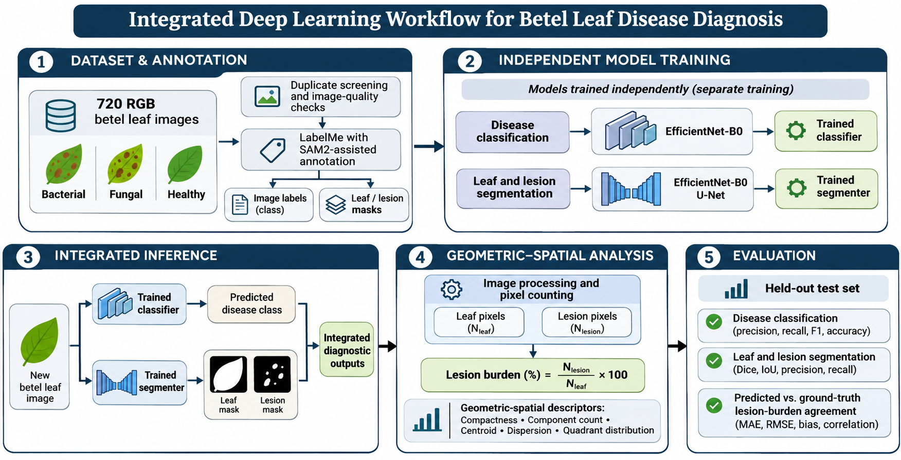
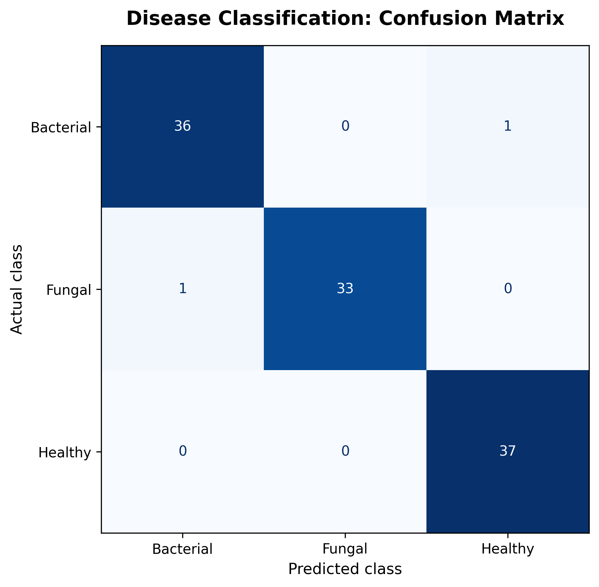
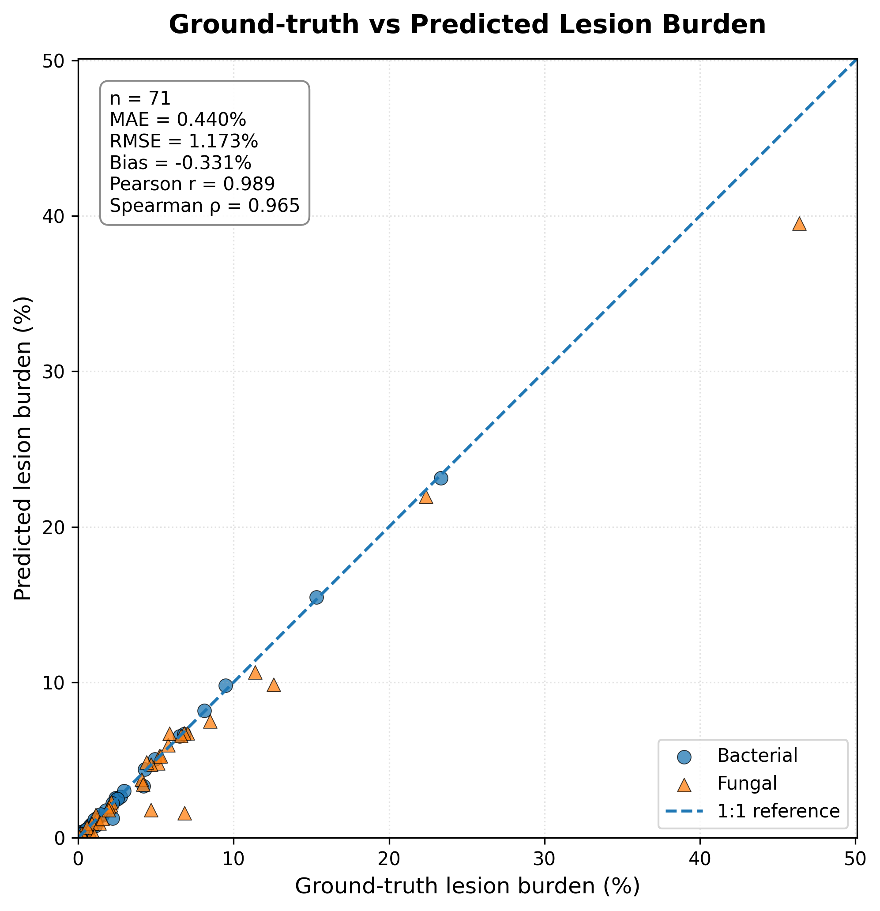
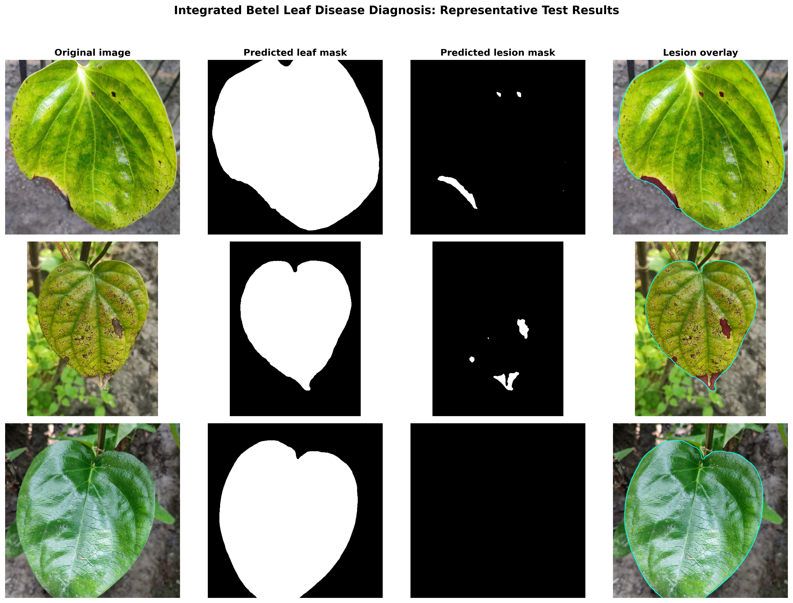

# Betel Leaf Disease Diagnosis Using an Integrated Deep Learning Framework

## Overview

This project presents an integrated deep learning framework for automated betel leaf disease classification, lesion segmentation, and quantitative lesion-burden estimation. Using RGB images of bacterial, fungal, and healthy betel leaves from Bangladesh, the framework combines disease classification, pixel-level lesion segmentation, and geometric–spatial feature extraction.

  

## Research Pipeline

Our integrated function successfully produced three outputs from one image:
Classification model classfies the disease category > segmentation model segments leaf and lesion area, and image processing calculates the number of lesion pixels and leaf pixels for semantic lesion burden calculation.

1. **Disease Classification**: EfficientNet-B0 for three-class disease classification.

2. **Leaf and Lesion Segmentation**: An EfficientNet-B0 U-Net predicts binary masks for leaf regions and disease lesions.

3. **Geometric Lesion Representation**: Image-processing techniques extract lesion area.

4.  **Quantitative Lesion Assessment**: NumPy calculates the number of foreground pixels in the predicted leaf and lesion masks. Estimation of lesion burden as the percentage of predicted leaf area occupied by predicted lesions.

5. **Integrated Diagnosis**: Sequential integration of classification, segmentation, and geometric feature extraction.

The classification and segmentation models are independently trained and integrated during inference.

## Dataset & Labelling
The dataset was obtained from the Project AgML repository. Three classes were retained: bacterial, fungal, and healthy.

ImageHash, Pillow, and manual inspection were used for duplicate and image-quality screening, resulting in a final dataset of 720 images.

Leaf and lesion regions were annotated using LabelMe. Its SAM2-based AI-assisted mask creation feature was used to accelerate annotation, followed by manual corrections where necessary.

## Models and Technologies

**Classification**: ResNet-50 and EfficientNet-B0

**Segmentation**: EfficientNet-B0 U-Net

**Image Processing**: NumPy, Pillow, SciPy, and scikit-image

**Deep Learning Framework**: PyTorch

**Development Environment**: Google Colab

EfficientNet-B0 was selected as the final classification model after comparison with ResNet-50.

## Held-Out Test Results

**Disease classification**:

| Metric | ResNet-50 | EfficientNet-B0 |
|:---|---:|---:|
| Macro Precision | 97.30% | 98.20% |
| Macro Recall | 97.22% | 98.20% |
| Macro-F1 | 97.27% | 98.20% |

EfficientNet-B0 overall accuracy: 98.15% (106/108 images).

  

Segmentation performance:

Threshold: 0.5

| Metric | Leaf Segmentation | Lesion Segmentation |
|:---|---:|---:|
| Dice | 0.9925 | 0.9171 |
| IoU | 0.9850 | 0.8469 |
| Precision | 0.9886 | 0.9485 |
| Recall | 0.9963 | 0.8877 |

### Lesion-Burden Estimation (71 Diseased Test Images)

| Metric | Result |
|:---|---:|
| Pearson Correlation | 0.989 |
| Spearman Correlation | 0.965 |
| MAE | 0.440 percentage points |
| RMSE | 1.173 percentage points |
| Mean Bias | -0.331 percentage points |

  

### Healthy-Image False Positives

| Metric | Result |
|:---|---:|
| Mean False-Positive Area | 0.008985% |
| Images with False Positives | 2 / 37 |
### Representative Integrated Results

  

## Research Contribution

The framework integrates disease recognition with lesion localization and quantitative geometric characterization, providing complementary information beyond conventional image-level classification. It also evaluates the agreement between predicted and ground-truth lesion measurements.

